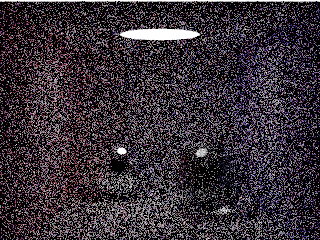
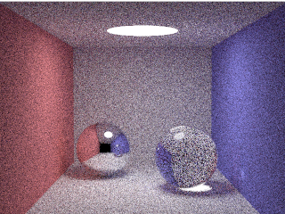
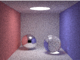
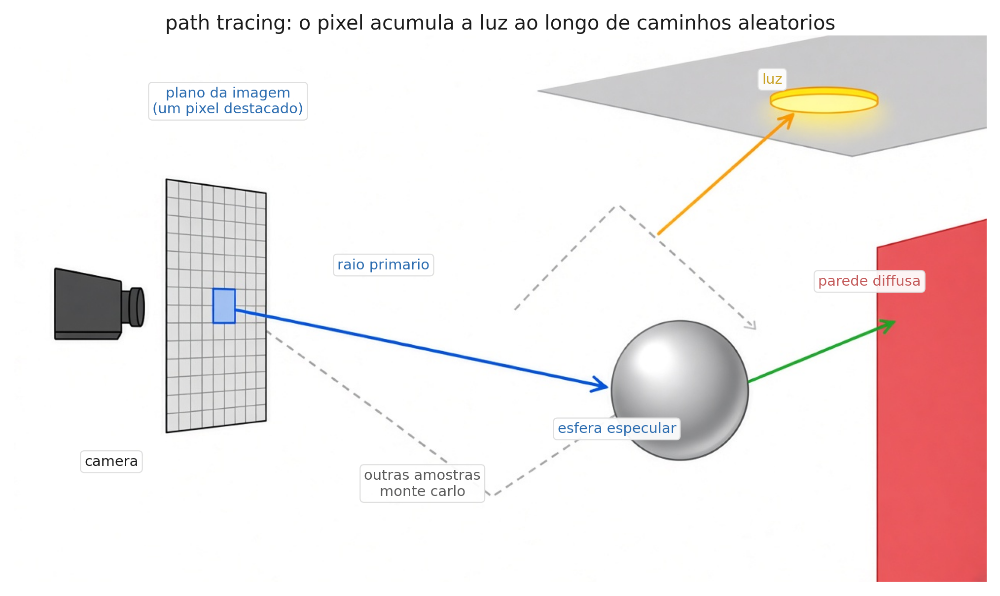
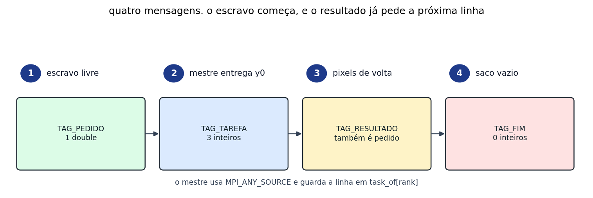
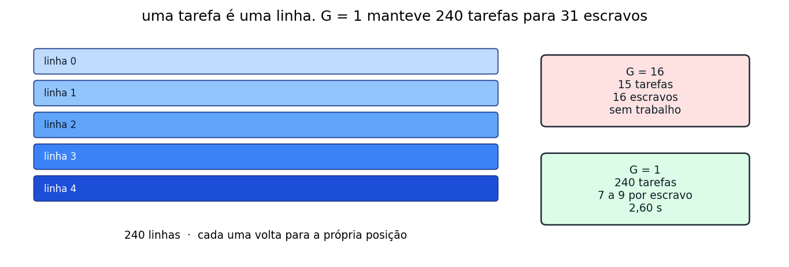
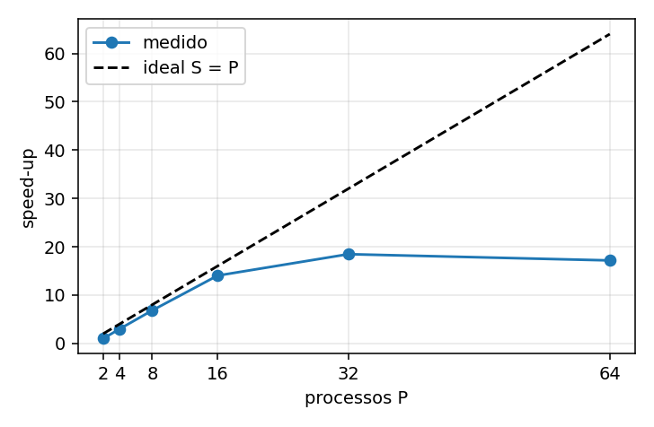
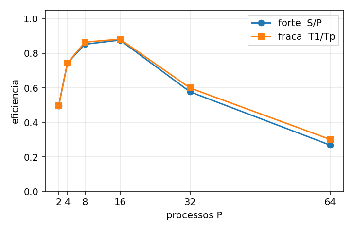

# T2 — path tracer smallpt em mestre/escravo com MPI

Bernardo Klein Heitz (usuário LAD: cp33001)

Versão paralela do path tracer do T1 (smallpt, Kevin Beason, 2008, reescrito em C11). Cada tarefa é um bloco de linhas da imagem. O processo 0 é o mestre e não renderiza.

## A cena

Cada pixel soma a luz de caminhos aleatórios. Mais amostras deixam a mesma cena mais limpa, e o custo cresce na mesma proporção. A campanha mediu a imagem da direita: 320×240, 64 amostras, 19.660.800 raios primários.




A imagem abaixo usa os mesmos 19.660.800 raios, em 160×120 com 256 amostras por pixel. Não entrou na campanha. Só mostra a cena com mais amostras em cada pixel.



O checksum da imagem de 64 amostras é 52244.207718229489, o mesmo das 140 execuções paralelas. A figura abaixo é o caminho de um raio, não a imagem medida.



Para gravar um PPM, fora do tempo medido:

```bash
srun --exclusive -N 1 -n 1 ./bin/smallpt_seq -w 320 -h 240 -s 64 -g 1 --image cena.ppm
```

## Como o trabalho é dividido

O escravo pede a primeira linha. Quando devolve os pixels, essa mensagem já vale como o próximo pedido. O mestre não escolhe um escravo: atende quem chegar, com `MPI_ANY_SOURCE`, e guarda a linha em `task_of[rank]`.



Uma tarefa é uma linha inteira. Partir a linha mudaria a semente. Com G = 1 ficam 240 tarefas para 31 escravos, de 7 a 9 linhas cada um. Com G = 16 ficam 15 tarefas, e 16 escravos não recebem nada.



## Compilar

No Atlântica, o `mpicc` não está no `PATH` do nó de login:

```bash
export PATH=/LADAPPs/OpenMPI/openmpi-4.1.1/bin:$PATH
export LD_LIBRARY_PATH=/LADAPPs/OpenMPI/openmpi-4.1.1/lib:$LD_LIBRARY_PATH
make
```

As duas versões usam as mesmas flags: `-std=c11 -O3 -ffast-math -Wall -Wextra`. O núcleo numérico é compilado uma vez com `gcc` e entra nos dois binários, para o checksum bater.

## Rodar

```bash
# sequencial (referência T1), 1 processo, sem MPI
srun --exclusive -N 1 -n 1 ./bin/smallpt_seq -w 320 -h 240 -s 8 -g 1

# paralelo. -g é a granularidade (linhas por mensagem).
srun --exclusive -N 2 -n 8 --distribution=block \
    ./bin/smallpt_mpi -w 320 -h 240 -s 8 -g 4

# escalabilidade fraca: --copies igual ao número de processos
srun --exclusive -N 2 -n 8 --distribution=block \
    ./bin/smallpt_mpi -w 320 -h 240 -s 8 -g 4 --copies 8

# custo de uma tarefa versus ida e volta da mensagem do mesmo tamanho
srun --exclusive -N 2 -n 32 --distribution=block \
    ./bin/smallpt_mpi -w 320 -h 240 -s 8 -g 4 --probe
```

A campanha que gerou o relatório usou `-w 320 -h 240 -s 64`, 10 repetições, nós atlantica03 e atlantica04, exclusivos. A granularidade escolhida foi `-g 1`, a de menor mediana em P = 32. P = 64 precisa de `srun -O`, porque a partição não deixa passar de 32 CPUs.

A primeira submissão parou em P = 64: `--oversubscribe` não autoriza mais processos do que CPUs. `scripts/campaign_rest.sbatch` completou P = 64, a escalabilidade fraca e o probe. O aviso em `results/raw/stderr.txt` é dessa tentativa interrompida. As 150 execuções de `results/runs.csv` fecharam com o mesmo checksum.

A campanha completa, sempre nos mesmos 2 nós:

```bash
sbatch scripts/campaign.sbatch
```

`W`, `H`, `SPP`, `REPS` e `G_LIST` podem ser passados na submissão, por exemplo `sbatch --export=ALL,W=320,H=240,SPP=8 scripts/campaign.sbatch`.

## O que a campanha mostrou

A referência sequencial, sem MPI, teve mediana 48,03 s (47,95 s a 48,20 s). O mestre não renderiza, então em 16 núcleos físicos o teto previsto era 15. Em P = 16 o speed-up foi 14,03.



P = 2 fica em 0,99 porque só existe um escravo. P = 32 sobe para 18,46, e não para 28: são 8 núcleos físicos com hyper-threading, e o ganho foi 1,32. P = 64 desce para 17,17, com dois processos por thread.



Na escalabilidade fraca a mesma imagem é repetida P vezes. Os raios primários crescem exatamente com P, e o custo de uma linha não muda. A eficiência fraca acompanha a forte até P = 16 (0,88) e as duas caem juntas a partir do hyper-threading. Não é falta de tarefa.

Uma linha custa 263 ms. A ida e volta da mensagem do mesmo tamanho (7680 bytes) custa 0,08 ms no mesmo nó e 0,35 ms no outro. As 240 mensagens somam cerca de 0,08 s, 3% dos 2,60 s de P = 32. Em G = 16 o tempo vai a 5,27 s porque faltam tarefas, não porque a mensagem ficou cara.

## Saída

Cada execução imprime uma linha `run,...` com tempo, checksum da primeira imagem, `copies_ok`, pixels, raios primários e número de tarefas. O checksum tem de ser o mesmo da versão sequencial. Linhas `balance,rank,tarefas,tempo_ocupado,host` mostram a carga de cada escravo. O modo `--probe` imprime `probe,...` com RTT no mesmo nó, RTT no outro nó e o tempo de renderizar uma tarefa.

## Reproduzir as tabelas

```bash
python3 scripts/summarize.py results/runs.csv
python3 scripts/plot.py
python3 docs/gerar_figuras.py
```

Os tempos brutos de cada execução ficam em `results/raw/` e a saída do Slurm em `results/slurm-*.out`.

## O que cada tag significa

| tag | direção | conteúdo |
|---|---|---|
| `TAG_PEDIDO` (1) | escravo para mestre | 1 double. o escravo está livre |
| `TAG_TAREFA` (2) | mestre para escravo | 3 ints: `y0`, número de linhas, id da tarefa |
| `TAG_RESULTADO` (3) | escravo para mestre | RGB das linhas. também vale como próximo pedido |
| `TAG_FIM` (4) | mestre para escravo | 0 ints. o saco acabou |
| `TAG_STATS` (9) | depois do cronômetro | tarefas feitas e tempo ocupado de cada escravo |

O mestre não manda o índice de volta dentro dos pixels. Como cada escravo segura no máximo uma tarefa, `task_of[rank]` diz onde gravar o bloco (`src/smallpt_mpi.c`).
